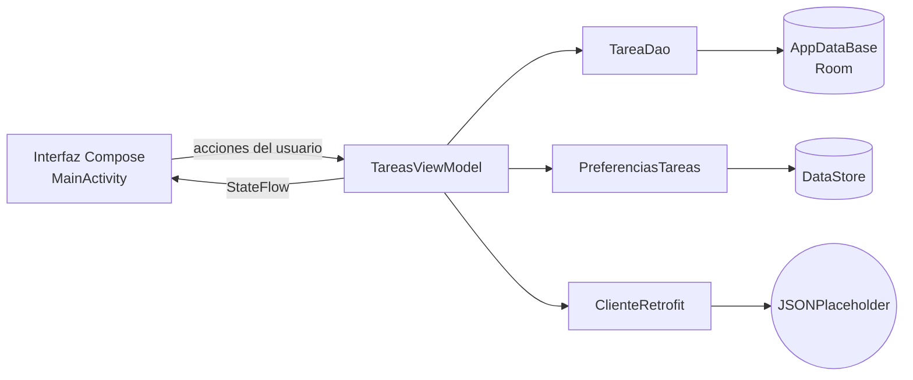

# Gestor Personal de Tareas

Aplicación móvil para **Android** desarrollada con **Kotlin** y **Jetpack Compose** que permite organizar tareas diarias, asignarles una prioridad, marcarlas como completadas, filtrar las pendientes y conservar toda la información en la memoria del teléfono, incluso después de cerrar la aplicación.

Proyecto de la práctica del módulo **Programación Multimedia y Dispositivos Móviles (PMDM)**.

---
 
## Índice
 
1. [Descripción](#1-descripción)
2. [Estado del proyecto](#2-estado-del-proyecto)
3. [Tecnologías y bibliotecas](#3-tecnologías-y-bibliotecas)
4. [Arquitectura y estructura de carpetas](#4-arquitectura-y-estructura-de-carpetas)
5. [Documentación técnica](#5-documentación-técnica)
   - [5.1 Configuración del proyecto](#51-configuración-del-proyecto)
   - [5.2 Modelo de datos: `Tarea`](#52-modelo-de-datos-tarea)
   - [5.3 Acceso a datos: `TareaDao`](#53-acceso-a-datos-tareadao)
   - [5.4 Base de datos: `AppDataBase`](#54-base-de-datos-appdatabase)
   - [5.5 Recursos](#55-recursos)
   - [5.6 Preferencias: `PreferenciasTareas`](#56-preferencias-preferenciastareas)
   - [5.7 Comunicaciones: Retrofit](#57-comunicaciones-retrofit)
   - [5.8 Coordinador: `TareasViewModel`](#58-coordinador-tareasviewmodel)
   - [5.9 Interfaz: `MainActivity`](#59-interfaz-mainactivity)
6. [Arquitectura de la aplicación](#6-arquitectura-de-la-aplicación)
7. [Estado de las funcionalidades](#7-estado-de-las-funcionalidades)
8. [Capturas de pantalla](#8-capturas-de-pantalla)
9. [Cómo ejecutar el proyecto](#9-cómo-ejecutar-el-proyecto)
10. [Pruebas](#10-pruebas)
11. [Incidencias conocidas y trabajo pendiente](#11-incidencias-conocidas-y-trabajo-pendiente)

---

## 1. Descripción
 
El **Gestor Personal de Tareas** está pensado para registrar tareas personales, académicas o profesionales. Funcionalidades previstas:
 
- Crear, consultar, editar y eliminar tareas.
- Asignar una **prioridad** (baja, media o alta) y marcar cada tarea como **completada**.
- Mostrar **solo las pendientes** mediante un interruptor cuya elección se recuerda entre ejecuciones.
- Guardar las tareas de forma **permanente** en una base de datos local.
- Consultar tareas de ejemplo de un servicio web (JSONPlaceholder).
- Compartir una tarea con otras aplicaciones instaladas en el dispositivo.

---

## 2. Estado del proyecto

El proyecto ya tiene lista toda la configuración inicial, los recursos visuales y el motor completo para guardar y leer tareas en el móvil:

- [x] **Configuración del proyecto (`Gradle`):** Instaladas las herramientas de pantalla (Jetpack Compose y Material 3), iconos extra, base de datos en el teléfono (Room + KSP), memoria de ajustes (DataStore) y conexión a Internet (Retrofit).
- [x] **Permisos y recursos (`AndroidManifest.xml` y `res`):** Configurado el permiso de Internet, los textos de la app en español (`strings.xml`) y el icono vectorial (`ic_tareas.xml`).
- [x] **Ficha de datos (`modelo/Tarea.kt`):** Define cómo es cada tarea (número identificador, título, descripción, prioridad y si está completada o pendiente) y crea la tabla `tareas`.
- [x] **Encargado de órdenes (`datos/TareaDao.kt`):** Contiene las funciones para leer la lista de tareas en directo (`Flow`), guardar una o varias tareas de golpe, modificarlas y borrarlas.
- [ ] **Base de datos local (`datos/AppDatabase.kt`):** Crea y abre la libreta principal (`tareas_db`) dentro de la memoria del teléfono asegurando que solo haya una conexión abierta a la vez.
- [ ] **Memoria de ajustes (`preferencias/`):** Pendiente de crear.
- [ ] **Conexión a Internet (`red/`):** Pendiente de crear.
- [ ] **Coordinador (`TareasViewModel.kt`) y pantalla principal (`MainActivity.kt`):** Pendiente de crear.

---

## 3. Tecnologías y bibliotecas
 
| Tecnología | Versión | Para qué se usa |
|---|---|---|
| **Kotlin** | 2.2.10 | Lenguaje de programación |
| **Jetpack Compose** + **Material 3** | BOM `2026.02.01` | Construcción de la interfaz |
| **Room** (`runtime`, `ktx`, `compiler`) | 2.8.4 | Base de datos local (SQLite) |
| **KSP** | 2.2.10-2.0.2 | Genera el código interno de Room al compilar |
| **DataStore Preferences** | 1.1.7 | Guardar la preferencia del filtro |
| **Retrofit** + **converter-gson** | 3.0.0 | Peticiones HTTP y conversión de JSON |
| **Lifecycle Runtime Compose** | 2.11.0 | Observar flujos de datos desde la interfaz respetando el ciclo de vida |
| **Material Icons Extended** | (según BOM) | Iconos de las acciones (editar, borrar, etc.) |
 
Versión mínima de Android: **API 26** (Android 8.0).

---

## 4. Arquitectura y estructura de carpetas
El código se separa por responsabilidades: cada carpeta se ocupa de una sola cosa.


```text
es.centro.gestortareas/
├── modelo/
│   └── Tarea.kt            # Ficha de una tarea 
├── datos/
│   ├── TareaDao.kt         # leer, insertar, actualizar y eliminar
│   └── AppDataBase.kt      # Construye y abre la base de datos "tareas_db"              
└── MainActivity.kt        
```
---
 
## 5. Documentación técnica
 
### 5.1 Configuración del proyecto
 
Las versiones se centralizan en el catálogo `gradle/libs.versions.toml`:

```toml
[versions]
kotlin    = "2.2.10"
ksp       = "2.2.10-2.0.2"   # debe ser compatible con la versión de Kotlin
room      = "2.8.4"
datastore = "1.1.7"
retrofit  = "3.0.0"
```
y se usan en `app/build.gradle.kts`:

```kotlin
dependencies {
    // Base de datos local (Room)
    implementation(libs.androidx.room.runtime)
    implementation(libs.androidx.room.ktx)
    ksp(libs.androidx.room.compiler)          // genera el código de Room al compilar
 
    // Preferencias del usuario
    implementation(libs.androidx.datastore.preferences)
 
    // Comunicaciones
    implementation(libs.retrofit)
    implementation(libs.retrofit.converter.gson)
 
    // Observación de datos desde la interfaz
    implementation(libs.androidx.lifecycle.runtime.compose)
}
```
**Permisos** (`AndroidManifest.xml`): únicamente `INTERNET`, necesario para consultar el servicio web. Es un permiso normal que no requiere diálogo al usuario. No se solicitan permisos innecesarios (SMS, Bluetooth, contactos o ubicación).
 
```xml
<uses-permission android:name="android.permission.INTERNET" />
```
 
---

## 5.2 Modelo de datos: `Tarea`
 
`modelo/Tarea.kt` define cómo es una tarea y, al estar anotada con `@Entity`, Room crea a partir de ella la tabla `tareas`.

```kotlin
@Entity(tableName = "tareas")
data class Tarea(
    @PrimaryKey(autoGenerate = true)
    val id: Int = 0,                      // lo asigna la base de datos al insertar
    val titulo: String,                   // nombre principal de la tarea
    val descripcion: String = "",         // texto opcional con más detalles
    val prioridad: String = "Media",      // "Baja", "Media" o "Alta"
    val completada: Boolean = false       // false = pendiente, true = terminada
)

```
| Campo | Tipo | Valor inicial | Descripción |
|---|---|---|---|
| `id` | `Int` | `0` | Identificador único. Con `0` se indica «aún sin guardar»; la base genera el número real |
| `titulo` | `String` | — (obligatorio) | Nombre de la tarea |
| `descripcion` | `String` | `""` | Detalles opcionales |
| `prioridad` | `String` | `"Media"` | Urgencia de la tarea |
| `completada` | `Boolean` | `false` | Estado de la tarea |

**Esquema de la tabla resultante en SQLite:**

| Columna | Tipo SQLite | Restricciones |
|---|---|---|
| `id` | `INTEGER` | Clave primaria, autoincremental |
| `titulo` | `TEXT` | `NOT NULL` |
| `descripcion` | `TEXT` | `NOT NULL` |
| `prioridad` | `TEXT` | `NOT NULL` |
| `completada` | `INTEGER` | `NOT NULL` (0 = pendiente, 1 = completada) |

Al ser una `data class`, para modificar una tarea se crea una **copia** que conserva el `id`, de modo que la base actualiza la misma fila:
 
```kotlin
val terminada = tarea.copy(completada = true)
```
---
 
### 5.3 Acceso a datos: `TareaDao`
 
`datos/TareaDao.kt` es una interfaz que declara las operaciones permitidas sobre la tabla. Room genera su implementación al compilar.

```kotlin
@Dao
interface TareaDao {
 
    // Todas las tareas, de la más reciente a la más antigua
    // Devuelve un Flow, cada vez que la tabla cambia, se emite la lista nueva
    @Query("SELECT * FROM tareas ORDER BY id DESC")
    fun obtenerTodas(): Flow<List<Tarea>>
 
    // Guarda una tarea. Si ya existe una con el mismo id, la reemplaza
    @Insert(onConflict = OnConflictStrategy.REPLACE)
    suspend fun insertar(tarea: Tarea)
 
    // Guarda varias tareas en una sola operación
    @Insert(onConflict = OnConflictStrategy.REPLACE)
    suspend fun insertarVarias(tareas: List<Tarea>)
 
    // Modifica una tarea ya guardada por su id 
    @Update
    suspend fun actualizar(tarea: Tarea)
 
    // Elimina definitivamente la tarea indicada
    @Delete
    suspend fun eliminar(tarea: Tarea)
}
```
 Operación | Anotación | ¿`suspend`? | Descripción |
|---|---|---|---|
| `obtenerTodas()` | `@Query` | No (devuelve `Flow`) | Lectura observable de todas las tareas |
| `insertar(tarea)` | `@Insert` | Sí | Añade una tarea |
| `insertarVarias(tareas)` | `@Insert` | Sí | Añade una lista de tareas de golpe |
| `actualizar(tarea)` | `@Update` | Sí | Guarda los cambios de una tarea existente |
| `eliminar(tarea)` | `@Delete` | Sí | Borra una tarea |

**Decisiones de diseño**
 
- Las **escrituras son `suspend`**: se ejecutan desde corrutinas sin bloquear el hilo principal, por lo que la pantalla no se queda congelada.
- La **lectura devuelve un `Flow`**: la interfaz recibe automáticamente la lista actualizada tras cada inserción, modificación o borrado, sin mantener una segunda lista en memoria.
- La consulta incluye `ORDER BY`, ya que sin él no se debe asumir un orden concreto.
  
---

### 5.4 Base de datos: `AppDataBase`

 
`datos/AppDataBase.kt` reúne la entidad `Tarea` con el DAO y abre la base de datos real en el almacenamiento interno del dispositivo con el nombre **`tareas_db`**.
 
- Expone `TareaDao` para que el resto de la aplicación acceda a los datos.
- Implementa el patrón **Singleton** mediante `@Volatile` y `synchronized`: solo existe **una instancia** de la base en toda la aplicación, lo que evita errores o inconsistencias cuando varias partes intentan leer o escribir a la vez.
- Se construye con el **contexto de aplicación** para no retener ninguna actividad.
- Nunca se usan consultas en el hilo principal (`allowMainThreadQueries()` no se utiliza).
---
### 5.5 Recursos
 
| Recurso | Ubicación | Descripción |
|---|---|---|
| Textos de la interfaz | `res/values/strings.xml` | Nombre de la app, títulos, botones y mensaje de lista vacía, centralizados en un único lugar |
| Icono de la aplicación | `res/drawable/ic_tareas.xml` | Icono **vectorial** propio; se ve nítido en cualquier densidad de pantalla |
 
Los textos se leen desde Compose con `stringResource(R.string.nombre)`.
 
---

### 5.6 Preferencias: `PreferenciasTareas`
 
`preferencias/PreferenciasTareas.kt` guarda con **DataStore** si el usuario quiere ver solo las tareas pendientes. Los datos de las tareas siguen en Room; DataStore se usa únicamente para esta preferencia de visualización.
 
```kotlin
private val Context.dataStore by preferencesDataStore(name = "ajustes_tareas")
 
class PreferenciasTareas(private val contexto: Context) {
 
    companion object {
        private val CLAVE_SOLO_PENDIENTES = booleanPreferencesKey("solo_pendientes")
    }
 
    // Lectura: si aún no hay nada guardado, vale false (mostrar todas)
    val soloPendientes: Flow<Boolean> = contexto.dataStore.data.map { preferencias ->
        preferencias[CLAVE_SOLO_PENDIENTES] ?: false
    }
 
    // Escritura: función suspendible
    suspend fun guardarSoloPendientes(activar: Boolean) {
        contexto.dataStore.edit { preferencias ->
            preferencias[CLAVE_SOLO_PENDIENTES] = activar
        }
    }
}
```
 
La declaración `by preferencesDataStore(...)` se hace **una sola vez, fuera de la clase**, para que solo exista un archivo de preferencias abierto. La lectura es un `Flow` y la escritura es una función `suspend`.
 
---
 
### 5.7 Comunicaciones: Retrofit
 
`red/ClienteRetrofit.kt` define la petición y construye el cliente; `red/TareaRemota.kt` recoge el JSON recibido.
 
```kotlin
interface TareasApi {
    @GET("todos?_limit=5")
    suspend fun obtenerTareasEjemplo(): List<TareaRemota>
}
 
object ClienteRetrofit {
    private const val URL_BASE = "https://jsonplaceholder.typicode.com/"
 
    val api: TareasApi by lazy {            // se crea una sola vez, al usarse por primera vez
        Retrofit.Builder()
            .baseUrl(URL_BASE)               // la URL base termina en "/"
            .addConverterFactory(GsonConverterFactory.create())
            .build()
            .create(TareasApi::class.java)
    }
}
```
 
```kotlin
data class TareaRemota(
    val id: Int,
    @SerializedName("title") val titulo: String,       // el JSON usa "title"
    @SerializedName("completed") val completada: Boolean
)
```
 
`TareaRemota` incluye la función `aTareaLocal()`, que convierte una tarea recibida de Internet en una `Tarea`. La función `obtenerTareasEjemplo()` es `suspend`, por lo que la petición se hace sin bloquear la interfaz.
 
---

### 5.8 Coordinador: `TareasViewModel`
 
`TareasViewModel` conecta la base de datos, las preferencias y la red con la pantalla. Conserva el estado ante giros del dispositivo y expone los datos como `StateFlow`.
 
```kotlin
// Combina, en tiempo real, la lista de Room con el filtro guardado en DataStore
val tareasVisible: StateFlow<List<Tarea>> = combine(
    dao.obtenerTodas(),
    soloPendientes
) { listaTareas, filtrarPendientes ->
    if (filtrarPendientes) listaTareas.filter { !it.completada } else listaTareas
}.stateIn(viewModelScope, SharingStarted.WhileSubscribed(5000), emptyList())
```
 
El filtro se aplica **en memoria** sobre la lista recibida: no se modifica ni se borra ninguna fila para ocultarla.
 
| Función | Qué hace |
|---|---|
| `agregarTarea(titulo, descripcion, prioridad)` | Crea y guarda una tarea (ignora títulos en blanco) |
| `alternarCompletada(tarea)` | Cambia el estado con `copy(completada = !tarea.completada)` y lo guarda |
| `eliminarTarea(tarea)` | Borra la tarea de la base de datos |
| `cambiarFiltroPendientes(activar)` | Guarda la preferencia en DataStore |
| `importarTareasDeInternet()` | Descarga las tareas de ejemplo con indicador de carga y aviso de error |
| `limpiarAviso()` | Retira el mensaje mostrado al usuario |
 
Todas las operaciones se lanzan con `viewModelScope.launch`, es decir, en segundo plano y ligadas a la vida del `ViewModel`.
 
---

### 5.9 Interfaz: `MainActivity`
 
La actividad solo conecta Android con Compose; la pantalla se describe con funciones `@Composable`.
 
| Componente | Descripción |
|---|---|
| `PantallaPrincipalTareas` | `Scaffold` con barra superior, botón flotante, interruptor del filtro, indicador de carga y lista |
| `TarjetaTarea` | Tarjeta de una tarea: casilla de completada, título (tachado si está terminada), descripción, prioridad con color y botón de eliminar |
| `DialogoNuevaTarea` | `AlertDialog` con campos de título y descripción y selector de prioridad |
 
Detalles de la interfaz:
 
- La lista usa `LazyColumn` con `key = { it.id }` para dar identidad estable a cada fila.
- Si no hay tareas se muestra un mensaje informativo en lugar de una lista vacía.
- Un `Snackbar` muestra los avisos de la descarga (éxito o error).
- El botón de descarga se deshabilita mientras hay una petición en curso, evitando peticiones simultáneas.
- El estado de la pantalla vive en el `ViewModel`, por lo que sobrevive a los giros.

---

## 6. Arquitectura de la aplicación
 
La interfaz nunca habla directamente con la base de datos ni con Internet: pasa por el `ViewModel`.
 

 
Estructura de carpetas actual:
 
```text
es.centro.gestortareas/
├── modelo/
│   └── Tarea.kt                  # Entidad: ficha de una tarea (tabla "tareas")
├── datos/
│   ├── TareaDao.kt               # Leer, insertar, actualizar y eliminar
│   └── AppDataBase.kt            # Abre la base de datos "tareas_db" (instancia única)
├── preferencias/
│   └── PreferenciasTareas.kt     # Filtro "solo pendientes" con DataStore
├── red/
│   ├── ClienteRetrofit.kt        # Interfaz de la API y cliente Retrofit
│   └── TareaRemota.kt            # Modelo de los datos que llegan de Internet
├── ui/theme/                     # Colores, tipografía y tema Material 3
├── TareasViewModel.kt            # Coordina datos, preferencias y red para la pantalla
└── MainActivity.kt               # Única actividad; pantalla principal y componentes
```
---

## 7. Estado de las funcionalidades
 
| Funcionalidad | Estado | Observaciones |
|---|---|---|
| Listado de tareas con `LazyColumn` y mensaje de lista vacía | Hecho | Muestra título, descripción, prioridad y estado |
| Crear tarea (título, descripción, prioridad) | Parcial | Falta validar mínimo 3 caracteres y mostrar el error junto al campo |
| Marcar como completada | Hecho | Se guarda en la base de datos |
| Editar tarea | Pendiente | |
| Eliminar tarea | Parcial | Elimina, pero sin diálogo de confirmación |
| Almacenamiento permanente (Room) | Hecho | Base de datos `tareas_db` |
| Filtro "Mostrar solo pendientes" (DataStore) | Hecho | Se conserva entre ejecuciones |
| Consulta a servicio web (Retrofit) | Parcial | Falta separar las tareas de ejemplo de las personales y el botón de reintento |
| Compartir una tarea (`ACTION_SEND`) | Pendiente | |
| Pruebas en dos emuladores y APK | Pendiente | |
 
---

## 8. Capturas de pantalla
 
Las imágenes están en la carpeta `docs/capturas`.
 
| Lista con tareas | Nueva tarea |
|---|---|
|  |  |
 
| Filtro de pendientes | Tareas de ejemplo (API) |
|---|---|
|  |  |
 
Demostraciones animadas:
 
| Crear una tarea | Persistencia al cerrar y reabrir |
|---|---|
|  |  |
 
---
 
## 9. Cómo ejecutar el proyecto
 
**Requisitos:** Android Studio actualizado y un emulador o dispositivo con **Android 8.0 (API 26) o superior**.
 
1. Clonar el repositorio:
```bash
git clone https://github.com/romanscriptt/GestorPersonalTareas.git
```
2. Abrir la carpeta con **Android Studio** y esperar a que termine la sincronización de Gradle.
3. Crear o iniciar un dispositivo virtual desde *Device Manager*.
4. Pulsar **Run** con la variante `debug`.
El APK de depuración estará en `entrega/app-debug.apk`.
 
### Emuladores utilizados
 
| | Emulador 1 | Emulador 2 |
|---|---|---|
| Nombre | _completar_ | _completar_ |
| Perfil de hardware | _completar (pantalla compacta)_ | _completar (pantalla grande)_ |
| API / imagen del sistema | _completar_ | _completar_ |
 
---
 
## 10. Pruebas
 
| Nº | Prueba | Resultado esperado | Emulador 1 | Emulador 2 |
|---|---|---|---|---|
| 1 | Crear una tarea válida | Se guarda y aparece en la lista | _pendiente_ | _pendiente_ |
| 2 | Intentar guardar un título vacío | Se muestra un error y no se crea | _pendiente_ | _pendiente_ |
| 3 | Editar una tarea | Los cambios se muestran correctamente | _pendiente_ | _pendiente_ |
| 4 | Marcar una tarea como completada | Cambia su estado y queda guardado | _pendiente_ | _pendiente_ |
| 5 | Cancelar una eliminación | La tarea no desaparece | _pendiente_ | _pendiente_ |
| 6 | Eliminar una tarea confirmando | Desaparece de la base de datos | _pendiente_ | _pendiente_ |
| 7 | Cerrar y volver a abrir la aplicación | Se recuperan las tareas guardadas | _pendiente_ | _pendiente_ |
| 8 | Activar el filtro y reiniciar | Se conserva la preferencia | _pendiente_ | _pendiente_ |
| 9 | Consultar la API con Internet | Se muestran las tareas recibidas | _pendiente_ | _pendiente_ |
| 10 | Consultar la API sin conexión | Se muestra un error y se permite reintentar | _pendiente_ | _pendiente_ |
| 11 | Compartir una tarea | Se abre el selector de aplicaciones | _pendiente_ | _pendiente_ |
| 12 | Cambiar la orientación del dispositivo | Sigue funcionando y conserva los datos | _pendiente_ | _pendiente_ |
 
---
 
## 11. Incidencias conocidas y trabajo pendiente
 
- **Validación del título:** actualmente solo se exige que no esté en blanco; falta el mínimo de 3 caracteres y el mensaje de error junto al campo.
- **Editar tarea:** sin implementar.
- **Eliminar:** falta el diálogo de confirmación.
- **Tareas de ejemplo:** deben mostrarse como una lista separada de las tareas personales (sin guardarlas en Room), usando `GET /todos?userId=1`, con identificador, título y estado, y con botón de reintento.
- **Compartir:** sin implementar (`ACTION_SEND`).
- **Selector de prioridad:** se hace con chips; el enunciado pide un menú desplegable.
- **Recursos:** la interfaz usa textos escritos directamente en el código; falta usar `strings.xml` y mostrar el icono `ic_tareas`.
- **Organización:** `TareasViewModel.kt` y los componentes de pantalla deben moverse a sus propias carpetas (`viewmodel/` y `ui/`).
---
